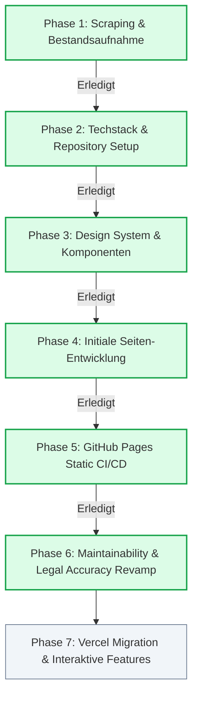

# Master Plan: se-alumni.de Relaunch & Maintainability Revamp

Dieser Masterplan definiert die schrittweise Vorgehensweise zur Neuentwicklung und nachhaltigen Wartbarkeits-Optimierung der Homepage des **Elitestudiengang Software Engineering Alumni e.V.** ([se-alumni.de](https://www.se-alumni.de)).

---

## Phasen-Übersicht

---

## Status-Übersicht

| Phase | Beschreibung | Status | Artefakte / Dokumente |
| :--- | :--- | :--- | :--- |
| **Phase 1** | Scraping von se-alumni.de, Dokumenten- & Asset-Download | **Abgeschlossen ✅** | `scraped_data/`, `_agents/SCRAPED_INVENTORY.md` |
| **Phase 2** | Techstack-Design, Toolchain-Vorbereitung | **Abgeschlossen ✅** | `_agents/TECHSTACK.md`, `scripts/scrape.py` |
| **Phase 3** | Next.js Projekt-Initialisierung & Design-System | **Abgeschlossen ✅** | `package.json`, `tailwind.config.ts`, `components/` |
| **Phase 4** | Initiale Seiten-Umsetzung (Home, Verein, Satzung, Events, Legal) | **Abgeschlossen ✅** | `app/**/page.tsx`, `content/*.ts` |
| **Phase 5** | GitHub Actions CI/CD Pipeline & GitHub Pages Deployment | **Abgeschlossen ✅** | `.github/workflows/deploy.yml` |
| **Phase 6** | **Revamp: Wartbarkeit, Rechtstext-Vollständigkeit, DSGVO Fonts & Single Source of Truth** | **Abgeschlossen ✅** | `content/club.ts`, `content/satzung.ts`, `content/beitragsordnung.ts`, `content/navigation.ts`, `README.md`, `_agents/MAINTENANCE.md` |
| **Phase 7** | Vercel Deployment & Interaktive Features (Formulare, Portal) | **Zukunftsphase 🚀** | Server Actions, Auth, DB |

---

## Detaillierte Roadmap

### Phase 1: Scraping & Bestandsaufnahme (Erledigt ✅)
- [x] Scraper-Script (`scripts/scrape.py`) entwickelt mit Umgehung von Cloudflare-Bot-Sperren via `curl.exe`.
- [x] Alle 9 Seiten von `se-alumni.de` vollständig erfasst (HTML + strukturierte Jimdo-Props).
- [x] Alle 3 offiziellen Vereins-PDFs heruntergeladen (`Aufnahmeantrag`, `Beitragsordnung`, `Vereinssatzung`).
- [x] 25 Bilder (Logos, Vorstands-Porträts, Header) in Originalauflösung gesichert (`scraped_data/images/`).
- [x] Markdown-Export aller Texte generiert (`scraped_data/site_content/`).
- [x] Detaillierte Bestandsaufnahme dokumentiert in `_agents/SCRAPED_INVENTORY.md`.

---

### Phase 2: Techstack-Design & Architektur (Erledigt ✅)
- [x] Evaluierung: Next.js (Static Export) vs. Astro vs. Reines HTML.
- [x] Architekturentscheidung getroffen: **Next.js (App Router, TypeScript, Tailwind CSS) mit `output: 'export'`**.
- [x] Nahtlose Brücke definiert: 100 % statisch für GitHub Pages heute, 0 % Rewrite für Vercel morgen.
- [x] Vollständige Architekturdokumentation in `_agents/TECHSTACK.md`.

---

### Phase 3: Repository & Design-System Setup (Erledigt ✅)
- [x] Next.js (App Router) mit TypeScript und Tailwind CSS im Workspace eingerichtet.
- [x] `next.config.mjs` konfiguriert für `output: 'export'`, `trailingSlash: true`, `images: { unoptimized: true }`.
- [x] Design-System & Stylesheet (Farben `#0e3193`, `#001d6e`, `#0849ff`, Typografie `Passion One` & `Source Sans 3`, Buttons mit `5px` Radius).
- [x] Wiederverwendbare Komponenten (`Header`, `Footer`, `CtaBanner`, `BoardSection`).

---

### Phase 4: Initiale Seiten-Umsetzung & Inhaltsmigration (Erledigt ✅)
- [x] Alle 9 Routen angelegt (`/`, `/verein/mitgliedschaft/`, `/verein/satzung/`, `/verein/beitragsordnung/`, `/veranstaltungen/`, `/impressum/`, `/datenschutz/`, `/cookie-einstellungen/`, `/widerruf/`).

---

### Phase 5: GitHub Pages Deployment Setup (Erledigt ✅)
- [x] GitHub Actions Workflow `.github/workflows/deploy.yml` erstellt.
- [x] Statischer Export nach `./out` verifiziert.

---

### Phase 6: Maintainability, Legal Accuracy & Architecture Revamp (Erledigt ✅)

#### 6.1 Vollständige Rechtstexte & Veranstaltungs-Chronik (Content Integrity)
- [x] **100 % Wortgetreue Vereinssatzung (`content/satzung.ts`):**
  - Beseitigung der gekürzten Zusammenfassungen in `app/verein/satzung/page.tsx` (insb. §§ 3, 7, 8, 9, 11, 12, 15).
  - Übernahme des vollständigen Originalwortlauts aus `scraped_data/site_content/satzung.md` inkl. aller Unterpunkte, Fristen, Quoren und Haftungsbeschränkungen (§§ 31a, 31b, 40 BGB).
  - Verbessertes Inhaltsverzeichnis mit vollständigen Paragraphen-Titeln (`§ 1 Name und Sitz` statt nur `§ 1`).
- [x] **100 % Wortgetreue Beitrags- und Kassenordnung (`content/beitragsordnung.ts`):**
  - Auslagerung in strukturierte Daten und Ergänzung des fehlenden Satzes in § 4 Vereinskonto.
- [x] **Vollständige Veranstaltungs-Chronik 2018–2024 (`content/events.ts`):**
  - Ergänzung der fehlenden Details zum Alumni-Seminar 2022 (Keynote Federico Tessmann, algoriddim, vollständige Agenda & Organisatoren).
  - Ergänzung des Alumni-Seminars 2021 im Backstage München (Keynote Bastian Nominacher, Co-CEO Celonis).
  - Ergänzung des Online-Seminars 2020.
  - Ergänzung des Alumni-Seminars 2019 in der Kleinen Aula der LMU (inkl. Gründungsworkshop des SE Alumni e.V. und aller Fachvorträge).
  - Ergänzung des Alumni-Seminars 2018 in der Kleinen Aula der LMU (inkl. aller Fachvorträge).

#### 6.2 Single Source of Truth (`content/club.ts` & `content/navigation.ts`)
- [x] **Zentrale Vereins-Konfiguration (`content/club.ts`):**
  - Vereinsname, Sitz, Registergericht (`Amtsgericht München`, `VR 208695`), Anschrift (`c/o Qplix GmbH, Nußbaumstraße 12, 80336 München`), Kontakt-E-Mail (`vorstand@se-alumni.de`), Bankverbindung (`IBAN`, `BIC`), Mitgliedsbeiträge (`0 €` / `50 €`), Deutschlandstipendium-Förderzeitraum und normalisierte PDF-Pfade an einer einzigen Stelle pflegen.
  - Dynamische Speisung von `Footer`, `Impressum`, `Datenschutz`, `Widerruf`, `Mitgliedschaft` und `Home` aus `content/club.ts`.
- [x] **Vorstands-Synchronisation (`content/board.ts`):**
  - Erweiterung um `isVertretungsberechtigt` / `impressumRole`, sodass das `Impressum` die vertretungsberechtigten Vorstände direkt aus `content/board.ts` bezieht (kein doppeltes Pflegen nach Vorstandswahlen).
- [x] **Zentrale Navigationsstruktur (`content/navigation.ts`):**
  - Einheitliche Datenquelle für Desktop-Header, Mobile-Drawer und Footer-Links.

#### 6.3 DSGVO-konforme Fonts, Styling-Konsistenz & Barrierefreiheit
- [x] **Self-Hosted Google Fonts via `next/font/google` (`app/layout.tsx`):**
  - Ablösung des externen Laufzeit-`@import url('https://fonts.googleapis.com/...')` in `app/globals.css` durch `next/font/google` (`Passion_One` & `Source_Sans_3`), damit beim Seitenaufruf **keine** IP-Adressen an Google übertragen werden (100 % DSGVO-konform).
- [x] **Tailwind Design-Tokens & `@layer components` (`app/globals.css`, `tailwind.config.ts`):**
  - Ersatz von 40+ hartcodierten Hex-Werten (`text-[#0e3193]`, `bg-[#001d6e]`) durch semantische Tailwind-Klassen (`text-primary`, `bg-navy`, `hover:text-primary-hover`).
  - Saubere Kapselung von `.btn-primary`, `.btn-banner`, `.btn-outline` und `.site-container` in `@layer components` ohne `!important`-Hacks.
- [x] **Barrierefreie Header-Navigation (`components/Header.tsx`):**
  - Unterstützung für `aria-expanded`, `aria-haspopup`, Schließen per `Escape`-Taste, Klick außerhalb sowie automatisches Schließen bei Routenwechsel (`usePathname`).

#### 6.4 Asset-Hygiene, Custom Domain & CI Quality Gates
- [x] **Saubere Dateinamen in `public/downloads/`:**
  - Umbenennung der PDFs in URL-sichere, zeitlose Dateinamen ohne Leerzeichen/Umlaute:
    - `public/downloads/aufnahmeantrag.pdf`
    - `public/downloads/vereinssatzung.pdf`
    - `public/downloads/beitragsordnung.pdf`
  - Entfernung der Duplikate (`Vereinssatzung%20Webseite.pdf`, etc.).
- [x] **GitHub Pages Domain-Konfiguration (`public/CNAME`):**
  - Anlage von `public/CNAME` (`se-alumni.de`), damit GitHub Actions die Custom Domain bei jedem Deployment beibehält.
- [x] **CI/CD Quality Gates (`.github/workflows/deploy.yml`):**
  - Typecheck (`npx tsc --noEmit`) und Linting im GitHub Actions Workflow sowie Build-Check bei Pull Requests.

#### 6.5 Dokumentation & Maintainer-Handbuch
- [x] **Root `README.md` & `_agents/MAINTENANCE.md`:**
  - Schritt-für-Schritt-Anleitung für zukünftige Vorstände (Neues Event eintragen, Vorstand nach Wahl aktualisieren, PDFs tauschen, lokale Entwicklung).
- [x] **Synchronisation von `_agents/`:**
  - Aktualisierung von `_agents/README.md`, `_agents/TECHSTACK.md` und `_agents/SCRAPED_INVENTORY.md` auf den neuen Architektur-Stand.

---

### Phase 7: Vercel Migration & Interaktive Features (Zukunft 🚀)
1. **Vercel Onboarding:**
   - GitHub Repo in Vercel importieren.
   - `output: 'export'` in `next.config.mjs` entfernen.
2. **Interaktive Features schrittweise freischalten:**
   - **Digitales Anmeldeformular:** Ersetzt das manuelle Ausfüllen und Scannen des PDFs.
   - **Event-RSVP:** Direkte Online-Zusage für Alumni-Seminare mit Teilnehmerliste.
   - **Mitgliederbereich:** Login via Magic Link / E-Mail für Alumnikontakte und Jahrgangsübersicht.
   - **Spenden & Beiträge:** Online-Zahlung via Stripe oder automatisierte SEPA-Mandate.
